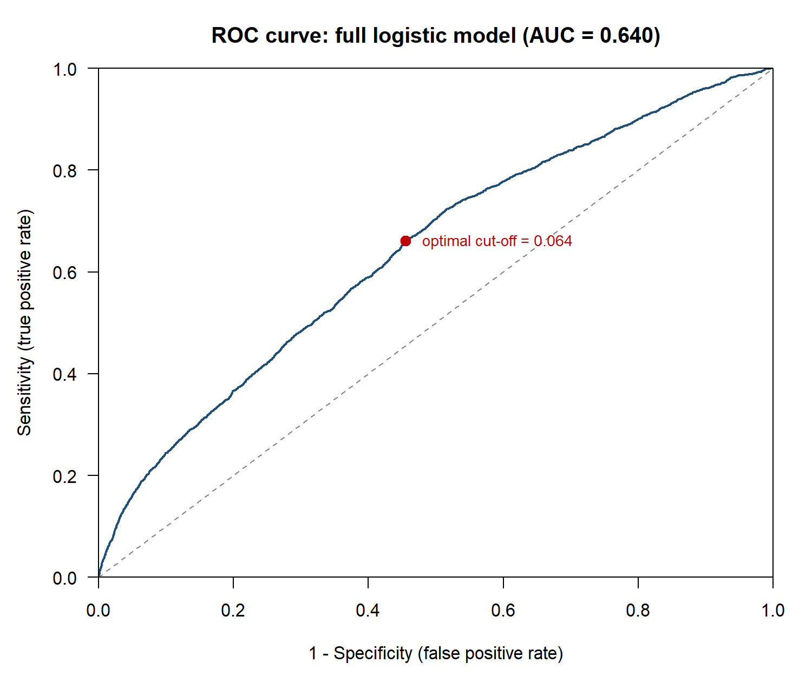

# HW3 Task 2: Logistic Regression

## Data and methods

The models use the same 43,364 Philadelphia crash records as Task 1; no rows are added or dropped beyond complete cases on DRINKING_D and the nine predictors.
Fitted by maximum likelihood with `glm(..., family = binomial)`. Odds ratios are exp(beta); 95% intervals use the profile-likelihood method, and Wald intervals are exported as a check. Classification thresholds are applied to fitted probabilities p-hat.

## Table 5. Full model: coefficients, odds ratios and 95% CI

| Term | beta | SE | z | p | OR | 95% CI for OR |
| --- | --- | --- | --- | --- | --- | --- |
| (Intercept) | -2.7325 | 0.0459 | -59.563 | <0.001 | 0.065 | 0.059 - 0.071 |
| FATAL_OR_M | 0.8140 | 0.0838 | 9.713 | <0.001 | 2.257 | 1.910 - 2.653 |
| OVERTURNED | 0.9289 | 0.1092 | 8.509 | <0.001 | 2.532 | 2.035 - 3.122 |
| CELL_PHONE | 0.0296 | 0.1978 | 0.149 | 0.8812 | 1.030 | 0.684 - 1.488 |
| SPEEDING | 1.5390 | 0.0805 | 19.107 | <0.001 | 4.660 | 3.974 - 5.450 |
| AGGRESSIVE | -0.5969 | 0.0478 | -12.493 | <0.001 | 0.551 | 0.501 - 0.604 |
| DRIVER1617 | -1.2803 | 0.2931 | -4.367 | <0.001 | 0.278 | 0.148 - 0.471 |
| DRIVER65PLUS | -0.7747 | 0.0959 | -8.081 | <0.001 | 0.461 | 0.380 - 0.553 |
| PCTBACHMOR | -0.0004 | 0.0013 | -0.286 | 0.7750 | 1.000 | 0.997 - 1.002 |
| MEDHHINC | 0.0000 | 0.0000 | 2.091 | 0.0365 | 1.000 | 1.000 - 1.000 |

Note on the two continuous predictors: MEDHHINC is in dollars, so its odds ratio is per $1 and prints as 1.000. Per $1,000 of median household income the odds ratio is 1.003 (coefficient re-scaled to thousands = 0.0028, p = 0.0365). For PCTBACHMOR, a 10-percentage-point increase multiplies the odds by exp(10 * -0.000371) = 0.9963.

McFadden pseudo-R2 = 0.0366; AIC = 18359.63; null deviance = 19035.8; residual deviance = 18339.6.

At alpha = 0.05 the full model flags FATAL_OR_M, OVERTURNED, SPEEDING, AGGRESSIVE, DRIVER1617, DRIVER65PLUS, MEDHHINC. CELL_PHONE, PCTBACHMOR are not significant.

## Table 6. Sensitivity, specificity and misclassification rate by cut-off

| Cut-off | Sensitivity | Specificity | Misclassification rate |
| --- | --- | --- | --- |
| 0.02 | 0.9835 | 0.0581 | 88.89 % |
| 0.03 | 0.9807 | 0.0639 | 88.35 % |
| 0.05 | 0.7348 | 0.4691 | 51.57 % |
| 0.07 | 0.2213 | 0.9138 | 12.59 % |
| 0.08 | 0.1847 | 0.9386 | 10.46 % |
| 0.09 | 0.1682 | 0.9460 | 9.86 % |
| 0.10 | 0.1642 | 0.9482 | 9.67 % |
| 0.15 | 0.1042 | 0.9722 | 7.75 % |
| 0.20 | 0.0229 | 0.9954 | 6.03 % |
| 0.50 | 0.0016 | 0.9999 | 5.73 % (lowest) |

The lowest misclassification rate occurs at cut-off 0.50 (5.73% misclassified). Because only 5.73% of the crashes involve a drinking driver, a cut-off that high assigns almost every crash to the non-DUI class: at 0.50 only 8 of 43,364 crashes are classified as DUI (the highest fitted probability in the sample is 0.520). The minimum error rate is therefore close to the error rate of simply predicting the majority class (94.27%), and it does not indicate good discrimination. The error rate also jumps sharply between cut-offs 0.03 and 0.07, where the predicted probabilities are concentrated.

## ROC curve, optimal cut-off and AUC

AUC = 0.6399 (95% CI 0.6286-0.6512, DeLong), which is poor under the usual 0.5-0.6 failing / 0.6-0.7 poor / 0.7-0.8 fair / 0.8-0.9 good / above 0.9 excellent scale. The optimal cut-off that minimises the distance to the upper-left corner is 0.0636, giving sensitivity 0.6608 and specificity 0.5452; the corresponding misclassification rate is 44.81%. Youden's J would choose 0.0624 instead (comparison only). Note that the cut-off that minimises the distance to the upper-left corner and the cut-off that minimises misclassification are not the same: the former balances sensitivity and specificity, the latter favours the majority class.

## Table 7. Reduced model (no PCTBACHMOR, no MEDHHINC)

| Term | beta | SE | z | p | OR | 95% CI for OR |
| --- | --- | --- | --- | --- | --- | --- |
| (Intercept) | -2.6519 | 0.0275 | -96.324 | <0.001 | 0.071 | 0.067 - 0.074 |
| FATAL_OR_M | 0.8093 | 0.0838 | 9.662 | <0.001 | 2.246 | 1.901 - 2.640 |
| OVERTURNED | 0.9398 | 0.1090 | 8.619 | <0.001 | 2.559 | 2.057 - 3.156 |
| CELL_PHONE | 0.0311 | 0.1978 | 0.157 | 0.8752 | 1.032 | 0.685 - 1.491 |
| SPEEDING | 1.5403 | 0.0805 | 19.128 | <0.001 | 4.666 | 3.980 - 5.457 |
| AGGRESSIVE | -0.5936 | 0.0477 | -12.433 | <0.001 | 0.552 | 0.503 - 0.606 |
| DRIVER1617 | -1.2716 | 0.2931 | -4.338 | <0.001 | 0.280 | 0.149 - 0.475 |
| DRIVER65PLUS | -0.7665 | 0.0958 | -8.004 | <0.001 | 0.465 | 0.383 - 0.558 |

## Table 8. AIC comparison

| Model | Parameters | Log-likelihood | AIC | BIC | Delta AIC |
| --- | --- | --- | --- | --- | --- |
| Full model (nine predictors) | 10 | -9,169.81 | 18,359.63 | 18,446.40 | 0.00 |
| Reduced model (seven binary predictors only) | 8 | -9,172.23 | 18,360.47 | 18,429.89 | 0.84 |

The full model has the lower AIC (18359.63 vs 18360.47; Delta AIC = 0.84), only 0.84 units better, so AIC does not justify dropping PCTBACHMOR and MEDHHINC. BIC penalises the two extra parameters more heavily and is lower for the reduced model (18429.89 vs 18446.40), so the two criteria disagree and the AIC advantage of the full model is too small to call a meaningful improvement.

## Predictors whose significance changed between models

- **AGGRESSIVE:** beta -0.5969 -> -0.5936; significant in both.
- **CELL_PHONE:** beta 0.0296 -> 0.0311; not significant in either.
- **DRIVER1617:** beta -1.2803 -> -1.2716; significant in both.
- **DRIVER65PLUS:** beta -0.7747 -> -0.7665; significant in both.
- **FATAL_OR_M:** beta 0.8140 -> 0.8093; significant in both.
- **OVERTURNED:** beta 0.9289 -> 0.9398; significant in both.
- **SPEEDING:** beta 1.5390 -> 1.5403; significant in both.

## Draft text for the Results section (Section 3c)

The full logistic model estimated on 43,364 crashes is significant overall relative to the intercept-only model (residual deviance 18339.6 vs null deviance 19035.8 on 43354 degrees of freedom). McFadden's pseudo-R2 is 0.037, so the nine predictors explain only a modest share of the variation in the drinking-driver indicator.

In the full model, FATAL_OR_M is significant (OR = 2.26, 95% CI 1.91-2.65; p < 0.001); OVERTURNED is significant (OR = 2.53, 95% CI 2.03-3.12; p < 0.001); SPEEDING is significant (OR = 4.66, 95% CI 3.97-5.45; p < 0.001); AGGRESSIVE is significant (OR = 0.55, 95% CI 0.50-0.60; p < 0.001); DRIVER1617 is significant (OR = 0.28, 95% CI 0.15-0.47; p < 0.001); DRIVER65PLUS is significant (OR = 0.46, 95% CI 0.38-0.55; p < 0.001); MEDHHINC is significant (OR = 1.00, 95% CI 1.00-1.00; p = 0.0365). The remaining coefficients are not statistically distinguishable from zero at the 5% level, so their odds ratios should be read as imprecise rather than as evidence of no relationship.

Because alcohol-involved crashes are only 5.73% of the records, a high predicted probability is rare. Across the assigned cut-offs the misclassification rate is minimised at 0.50 (5.73% misclassified), while sensitivity and specificity trade off against each other. The ROC curve reaches an AUC of 0.640, which is poor on the standard scale, and the cut-off closest to the upper-left corner is 0.0636.

Dropping PCTBACHMOR and MEDHHINC leaves the seven binary coefficients essentially unchanged (largest change in beta = 0.0109) and no predictor switches significance. The full model has the lower AIC (18359.63 vs 18360.47; Delta AIC = 0.84), only 0.84 units better, so AIC does not justify dropping PCTBACHMOR and MEDHHINC. BIC penalises the two extra parameters more heavily and is lower for the reduced model (18429.89 vs 18446.40), so the two criteria disagree and the AIC advantage of the full model is too small to call a meaningful improvement.

## Sources

- Logistic Regression Data.csv, provided with the assignment; one row per crash.
- HW 3 - Instructions.pdf, pp. 7-8 (logistic regression, cut-offs, ROC, AUC, reduced model, AIC) and pp. 11-12 (Results requirements).
- output/task1_handoff.txt (same CSV, same nine predictors, no bivariate screening).
- pROC package documentation for `roc`, `coords`, `auc` and `ci.auc`.
