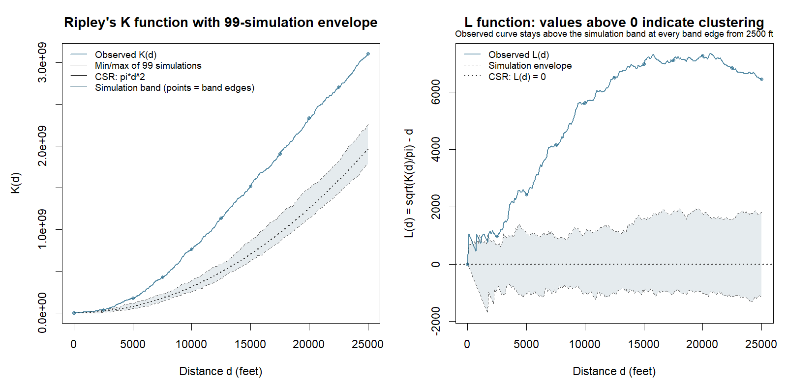
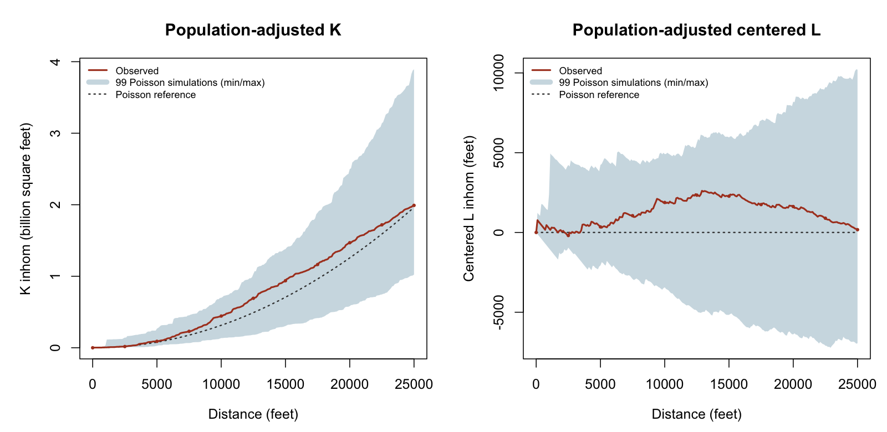
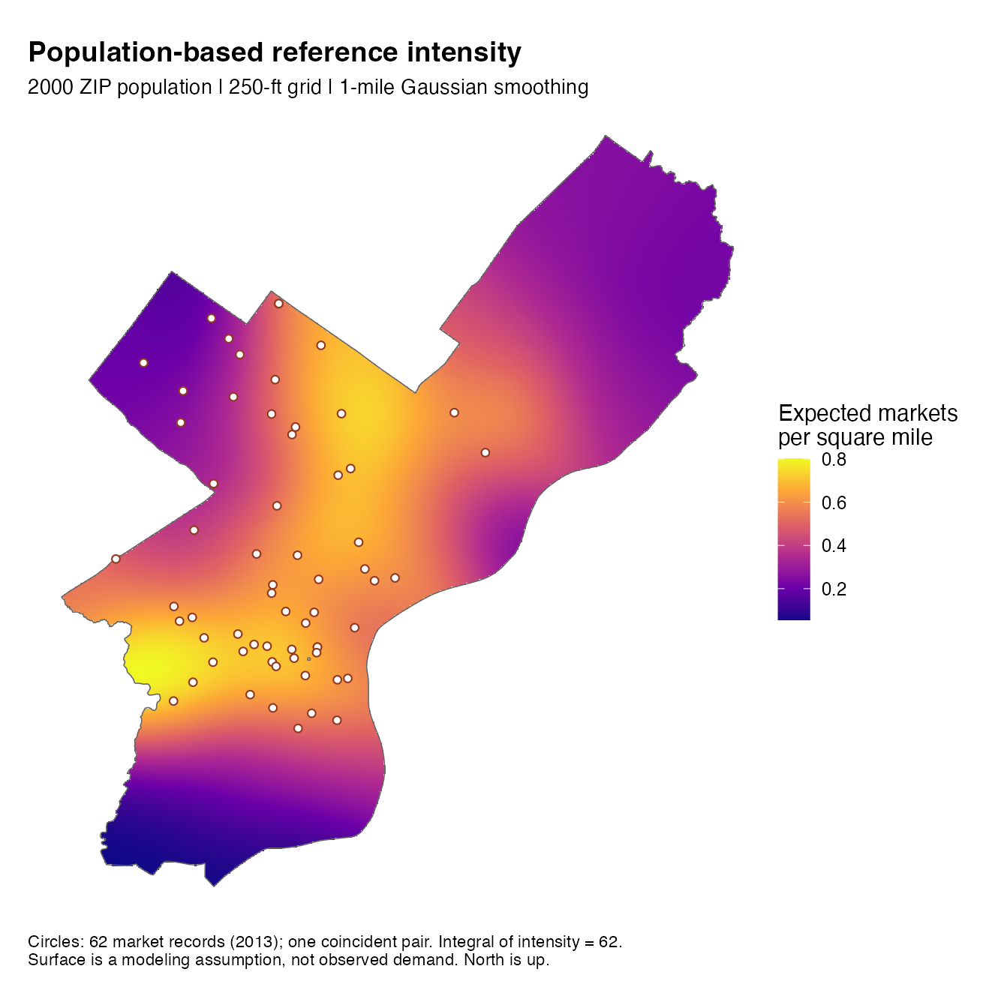
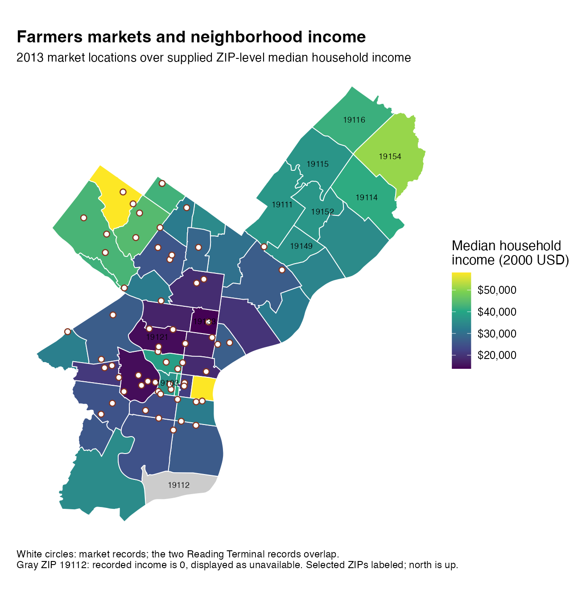

```{r setup, include=FALSE}
knitr::opts_chunk$set(echo=FALSE,warning=FALSE,message=FALSE)
z <- read.csv('../data/processed_kinhom/zip_market_summary.csv')
kc <- read.csv('../output/table_04_kinhom_values.csv')
kb <- read.csv('../output/table_02_kfunction_bands.csv')
ne <- c(19111,19114,19115,19116,19149,19152,19154)
```

# A. Introduction

Farmers markets can improve access to fresh food, but their benefits depend partly on where they operate. This report examines whether Philadelphia's 2013 farmers markets were randomly distributed, clustered, or dispersed within the city. It uses nearest neighbor analysis and Ripley's K-function to examine different spatial scales, then compares market locations with ZIP-code median household income. These analyses describe geographic patterns; they do not directly measure residents' travel access or explain why markets chose particular locations.

# B. Methods

## B.a. Complete spatial randomness and hypotheses

Complete spatial randomness (CSR) means a homogeneous Poisson process: intensity is constant across the study area, and counts in disjoint areas are independent. Conditional on the observed number of markets, locations are independent and uniformly distributed within Philadelphia. The null hypothesis is CSR. Alternatives are clustering, with more nearby points than CSR predicts, or dispersion, with fewer nearby points. Statistical departures are assessed at the 5% level, with the specific simulation-envelope level explained below. Rejecting CSR alone does not distinguish interactions between markets from differences in population or suitable land.

## B.b. Quadrat analysis

Quadrat analysis divides the study area into cells and compares their point counts with counts expected under CSR. Equal-area cells have equal expected counts; boundary cells require adjustments for their smaller areas. A variance substantially above the mean suggests clustering, whereas a smaller variance suggests regularity. A count-based goodness-of-fit test can assess departures from the null. However, results depend strongly on grid size, shape, and placement; sparse cells undermine approximations, and counts discard locations within cells. These limitations make quadrats a less informative stand-alone method here. Quadrat analysis was not performed.

## B.c. Nearest neighbor analysis

The study window is the supplied Philadelphia boundary, covering approximately 142.4 square miles. All 62 market records are retained, including two separately listed businesses at the Reading Terminal location. Coordinates use Pennsylvania South State Plane, EPSG:2272, in US survey feet. Nearest neighbor analysis averages the straight-line distance from each market to its closest other market. With $n$ points, area $A$, intensity $\lambda=n/A$, and nearest neighbor distances $d_i$,

$$
\bar d_o=\frac{1}{n}\sum_{i=1}^{n}d_i,\qquad
\bar d_e=\frac{1}{2\sqrt{\lambda}},\qquad
R=\frac{\bar d_o}{\bar d_e}.
$$

The conventional approximate CSR test uses

$$
SE=\sqrt{\frac{4-\pi}{4\pi\lambda n}},\qquad
z=\frac{\bar d_o-\bar d_e}{SE}.
$$

Here $\bar d_o$ and $\bar d_e$ are the observed and expected means, and $SE$ is the standard error. Values $R<1$ suggest clustering; $R>1$ suggests dispersion. A two-sided test rejects when $|z|>1.96$ at $\alpha=0.05$. The R analysis also checks the conclusion using the boundary-adjusted Clark-Evans test and 99 uniform simulations in the same window.

This method summarizes only the closest neighbor, depends on the chosen boundary, and can miss patterns at larger scales. A hospital analogy illustrates another limitation: facilities can be close together because they serve concentrated populations, without attracting one another. Markets likewise depend on customers and available sites. Straight-line distances also omit street routes and travel barriers.

## B.d.i–ii. K/L functions and distance settings

K-function analysis counts all other points within distance $d$ of a typical point, scaled by intensity:

$$
K(d)=\frac{E[\text{number of other points within }d]}{\lambda},
\qquad K_{CSR}(d)=\pi d^2.
$$

The R function `Kest` estimates

$$
\widehat K(d)=\frac{A}{n(n-1)}
\sum_i\sum_{j\ne i}I(d_{ij}\le d)e_{ij},
$$

where $d_{ij}$ is pairwise distance, $I$ indicates whether the pair is within $d$, and $e_{ij}$ is its edge weight. [Kest documentation](https://search.r-project.org/CRAN/refmans/spatstat.explore/html/Kest.html)

The usual transformation is $L(d)=\sqrt{K(d)/\pi}$, whose CSR benchmark is $d$. Our script plots the centered form $L_c(d)=L(d)-d$, although the saved figure calls it “L.” Its CSR benchmark is zero. Positive values indicate an excess of nearby pairs relative to homogeneous CSR; they are not literal extra neighbors or additional travel distances. [L-function documentation](https://search.r-project.org/CRAN/refmans/spatstat.explore/html/Lest.html)

Following the assignment, the script begins at zero and uses ten increments of 2,500 feet: $d_j=0+2,500j$, $j=1,\ldots,10$. Thus reported positive distances span 2,500–25,000 feet. These are prescribed settings rather than estimated travel thresholds; a 100-foot grid draws the curves between reported distances.

## B.d.iii. Simulation envelopes

The analysis generates 99 independent uniform patterns, each containing 62 points inside the same city boundary, using seed 671. Each receives the same K estimator. The minimum and maximum simulated values at each distance form a pointwise envelope. An observed curve above it supports clustering at that distance; below it supports dispersion. For a fixed distance, the min/max envelope has nominal two-sided rejection level $2/(99+1)=0.02$, subject to ties. It is not a simultaneous 95% confidence band. The one-sided clustering probability is

$$
p(d)=\frac{1+\#\{\widehat K_{sim}(d)\ge\widehat K_{obs}(d)\}}{100}.
$$

Its minimum is 0.01. Examining many distances does not turn these pointwise comparisons into one global test. [Envelope documentation](https://search.r-project.org/CRAN/refmans/spatstat.explore/help/envelope.html)

## B.d.iv. Boundary correction

Markets near a boundary may have unobserved neighbors outside the window, causing undercounts. Ripley's isotropic correction increases a pair's contribution according to the fraction of its circular neighborhood that is observable. The R analysis uses this correction because `Kest` supports Philadelphia's polygonal window. ArcGIS's Simulate Outer Boundary Values method instead adds mirrored points outside the boundary for neighbor counting. It is distinct from generating the 99 reference patterns. The assignment requests that ArcGIS method; the supplied R results are a substitute and do not reproduce that setting. [Esri documentation](https://pro.arcgis.com/en/pro-app/3.4/tool-reference/spatial-statistics/multi-distance-spatial-cluster-analysis.htm)


## B.d.v. Population-based inhomogeneous K (Part C)

Uniform CSR may be inappropriate if markets follow an unevenly distributed population. We construct an external reference from the supplied **2000 ZIP populations**, rather than estimate intensity from the market locations themselves. Each ZIP's population is divided by its polygon area, assigned to a 250-foot grid, and Gaussian-smoothed with a one-mile (5,280-foot) standard deviation. Boundary normalization prevents artificially low values at the city edge. The resulting surface is rescaled so its integral over Philadelphia equals 62 expected markets. Grid size and smoothing distance are modeling choices, not observed service areas. ZIP 19112's recorded zero population is retained before smoothing; nearby population supplies positive smoothed intensity. No area is removed from the city window.

`Kinhom` weights each pair by the inverse of its two local intensities and applies isotropic edge correction. We set `renormalise=FALSE` because the population-based surface has already been scaled, and use the same 0–25,000-foot radius grid as Part B. We report $L_{inhom,c}(d)=\sqrt{K_{inhom}(d)/\pi}-d$; the Poisson reference is zero. Ninety-nine independent inhomogeneous Poisson patterns are simulated inside the **original city polygon** using seed 671. Their expected count is 62, but their realized counts vary. Each simulated curve receives the same estimator and fixed intensity surface.

The min/max envelope is pointwise and exploratory: intensity's total rate is fitted from the observed count, and uncertainty about population, smoothing, and the historical data is not simulated. Unlike Part B's fixed-count simulations, these allow count variation; therefore a wider envelope cannot be attributed to population adjustment alone. A curve inside this envelope is compatible with this particular reference, not proof that population fully explains market placement.

\newpage

# C. Results

## C.a. Nearest neighbor analysis

Mean nearest neighbor distance is 3,112.9 feet, compared with a CSR expectation of 4,001.4 feet. The index is $R=0.778$, with $z=-3.345$ and two-sided $p=0.000824$. We reject CSR in the direction of clustering. The boundary-adjusted Clark–Evans result ($R=0.7091$; two-sided $p=0.00001176$) and the simulation check (one-sided $p=0.01$) support this conclusion.

## C.b.i. K-function analysis

Using the prescribed zero beginning distance and 2,500-foot increments, observed K exceeds the simulation envelope at all ten positive reported distances, 2,500–25,000 feet. Each has a one-sided rank $p=0.01$, supporting rejection of homogeneous CSR toward clustering at those distances. At 2,500 feet, observed K is 37.8 million square feet, above the upper envelope of 31.8 million. At 25,000 feet, it is 3.11 billion, above 2.26 billion. These are cumulative neighborhoods, not ten separate rings.

Centered L is positive at every reported distance and reaches 7,260 feet at the 20,000-foot band. This summarizes the transformed departure from CSR, not a literal gain in distance or neighbors. The 22,500- and 25,000-foot bands exceed the approximately 22,384-foot recommended range recorded in the analysis, so the largest-distance estimates merit caution. These pointwise results agree with nearest neighbor analysis without establishing a global envelope test or a population-adjusted conclusion.


```{r k-curve, fig.cap='Part B: homogeneous K and centered L with the min/max envelope of 99 fixed-count CSR simulations. These are pointwise comparisons.', out.width='100%'}

```

\newpage

## C.b.ii. Population reference and geographic gaps (Part C)

Low population alone is not a convincing explanation for the northeastern gap. For example, ZIPs 19111 and 19149 contain 58,672 and 48,857 residents in the supplied 2000 data but no market records in 2013. Seven selected northeastern ZIPs (19111, 19114, 19115, 19116, 19149, 19152, and 19154) together contain **`r format(sum(z$Pop2000[z$ZipCode %in% ne]),big.mark=',')` residents** and zero listed markets. This describes those ZIPs, not a formally defined regional boundary or residents' ability to cross a ZIP boundary to shop.

The assignment asks for an expectation without running an additional analysis: we would expect population adjustment to reduce some apparent citywide clustering, while populated areas without markets would remain policy-relevant. As an additional Part C analysis, the observed Kinhom curve is **inside the simulated envelope at all ten positive reported distances**. Its smallest one-sided clustering rank probability is `r sprintf('%.2f',min(kc$p_cluster[kc$distance_ft>0]))`. Thus this exploratory analysis does not detect excess clustering beyond the chosen population-based reference at these band edges.

For context, at 10,000 feet centered L decreases from `r format(round(kb$L_observed_iso[kb$distance_ft==10000]),big.mark=',')` feet in Part B to `r format(round(kc$L_inhom[kc$distance_ft==10000]),big.mark=',')` feet in Part C. This suggests that allowing uneven intensity changes the interpretation substantially. It does **not** establish that population is the sole explanation, particularly given the differing count assumptions and broad reference envelope.

```{r adjusted-curve, fig.cap='Population-based Kinhom and centered L. Shading is the min/max of 99 plug-in Poisson simulations, not a simultaneous confidence band.', out.width='90%'}

```

```{r adjusted-table, results='asis'}
t <- kc[kc$distance_ft>0,c('distance_ft','L_inhom','p_cluster','envelope_position')]
t$L_inhom <- round(t$L_inhom)
knitr::kable(t,row.names=FALSE,col.names=c('Distance (ft)','Centered L (ft)','Upper-tail rank p','Envelope position'),
  caption='Population-adjusted results at the ten prescribed band edges.',booktabs=TRUE)
```

\newpage

```{r intensity-map, fig.cap='Assumed population-proportional market intensity. The raster approximates ZIP population density; it does not reveal within-ZIP population or observed demand.', out.width='75%', fig.align='center'}

```

# D. Discussion

## D.a. Agreement between nearest neighbor and K results

Both methods reject **homogeneous CSR toward clustering**. Nearest neighbor analysis finds a shorter average nearest-market distance than the uniform reference; K finds excess cumulative pairs at every positive reported band edge. Their agreement describes the observed arrangement relative to a uniform citywide baseline. The population-based extension addresses a different null and does not contradict that result.

## D.b. Visual expectations and method limitations

The maps show many nearby markets in central and western neighborhoods and large gaps in northeastern ZIPs, matching the homogeneous analyses. However, the city includes very different residential and nonresidential environments. NNA reduces the pattern to one distance per market; K accumulates pairs over multiple scales and is sensitive to boundary correction at large distances. Two records at Reading Terminal represent one mapped location. ZIP smoothing, a one-mile bandwidth, a sample of 62 records, and the 2000/2013 time mismatch limit how specifically we can interpret the adjusted result. Neither straight-line distance nor point density measures prices, opening hours, transit access, or market capacity.

\newpage

```{r income-map, fig.cap='Required descriptive income map: 2013 farmers markets over 2000 median household income by ZIP. White circles denote markets; the coincident Reading Terminal pair overlaps.', out.width='75%', fig.align='center'}

```

## D.c. Median household income and market presence

The map does **not** support a simple rule that lower-income ZIPs always have fewer markets. Low-income ZIP 19104 (median household income $14,842) has five listed markets; 19121 ($14,780) has two. ZIP 19133 ($13,789) has one, whereas 19134 ($20,067) has none. At the other end, 19118 ($57,996) has two, but 19106 ($58,018) has none. Several northeastern ZIPs have moderate or higher incomes but no listed markets. These contrasting examples support a mixed visual relationship, not an income effect. No income association test was performed, as requested. ZIP 19112's recorded income of zero is shown as unavailable rather than interpreted as a zero-dollar household income.

## D.d. What can we conclude?

The 2013 market records were clustered relative to a uniform distribution within Philadelphia. We cannot infer that markets attract one another, that population fully explains their locations, or that a particular organization caused the pattern. Under our coarse population-based Poisson reference, the observed adjusted K remains within the envelope at all reported band edges. Nor does non-rejection establish equitable access: a citywide curve can coexist with populated ZIPs that contain no market.

\newpage

## D.e. Policy implications

Planning should prioritize **populated areas with limited fresh-food access**, rather than seek equal geographic spacing. The northeastern ZIP examples are candidates for further investigation, alongside low-income areas without markets such as 19134. Before choosing sites, assess nearby grocery stores, transit and walking routes, residents' needs, suitable operating space, and vendor demand. Pilot markets or mobile markets could then be evaluated using attendance and affordability measures.

Payment access also matters. In the supplied 2013 attributes, **49 of 62** records have `ACCEPT_SNA = Yes`. The EBT field contains 40 `Yes`, 11 `Yes*`, and 11 `No`; the starred code is preserved because its qualifier has not been verified. Policy proposals could support payment equipment and nutrition-benefit outreach, but these historical fields should be updated before implementation. The results justify targeted investigation and community engagement, not a claim that adding markets alone will resolve food-access inequities.


# Data and references

- Course-supplied **HW 4 - Instructions.docx**, market and Philadelphia boundary shapefiles, and **Philadelphia_ZipCodes**. Market vintage: 2013, attributed by the assignment to PASDA; ZIP population and median household income: 2000.
- Group A/B scripts and outputs in `rowen37/MUSA-500-stats/assignment4`, retrieved at commit `a3e533b` (28 November 2026). Part C preserves their raw results and corrects interpretive wording in this integrated report.
- [spatstat Kest](https://search.r-project.org/CRAN/refmans/spatstat.explore/html/Kest.html), [Lest](https://search.r-project.org/CRAN/refmans/spatstat.explore/html/Lest.html), [Kinhom](https://search.r-project.org/CRAN/refmans/spatstat.explore/html/Kinhom.html), and [simulation envelopes](https://search.r-project.org/CRAN/refmans/spatstat.explore/html/envelope.html).
- [Esri: Multi-Distance Spatial Cluster Analysis](https://pro.arcgis.com/en/pro-app/3.4/tool-reference/spatial-statistics/multi-distance-spatial-cluster-analysis.htm).

**Software disclosure:** Analysis and maps were produced in R. The assignment's ArcGIS-specific Simulate Outer Boundary Values run and graphical screenshot are not supplied; isotropic correction is a documented substitute, not an equivalent implementation. The hospital comparison is conceptual because the class slides were not included in the repository. See `README.txt` for reproduction and integration notes.
